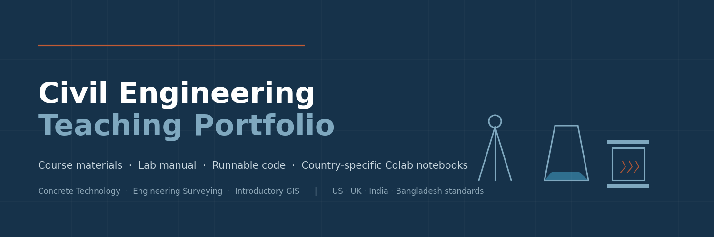
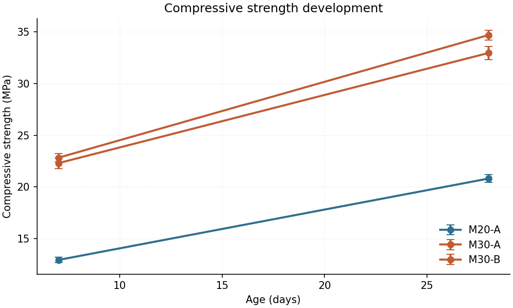
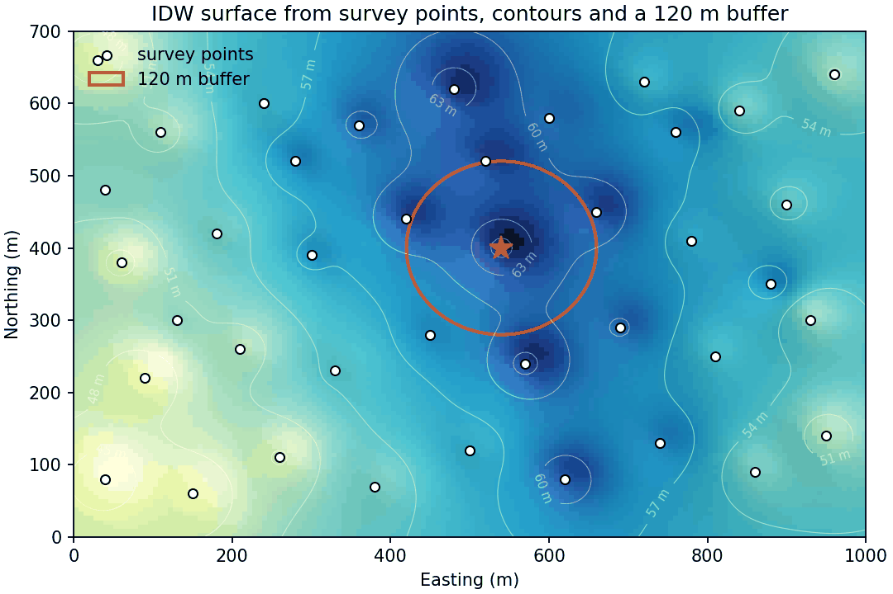
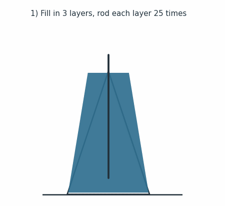
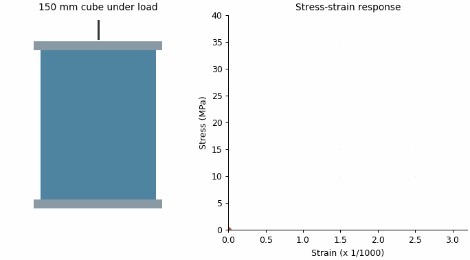

# Civil Engineering Teaching Portfolio




> Original, ready-to-teach materials for three core civil engineering courses, plus a runnable,
> standards-aware concrete-testing toolkit with country-specific Google Colab notebooks
> (United States · United Kingdom · India · Bangladesh).

**Author:** Syed Rafi Ahmed
**Purpose:** Supporting teaching portfolio for faculty job applications.
**Version:** 1.2.0 — course documentation, verified resources, and expanded test suite complete; standard values re-verified against public sources; slide decks and advanced modules planned (see [ROADMAP.md](ROADMAP.md)).

---

## About the author

This portfolio was prepared by Syed Rafi Ahmed as evidence-based teaching material for the
courses documented here — Concrete Technology, Engineering Surveying, and Introductory GIS —
together with the analysis code in `code/`. Contact:
[github.com/SyedRafiAhmedGIS](https://github.com/SyedRafiAhmedGIS).
<!-- Author: extend this section with your role, institution, degrees, years of
     teaching, and contact email — and ONLY details you can defend in an interview.
     Delete anything you cannot support. -->

## Authorship and provenance

I wrote this portfolio for my own teaching use with assistance from AI tools, which
helped draft structure and first-pass text. I reviewed, corrected, and verified the
content — including a technical check of the standard values against public sources
— and I take full responsibility for everything published here. All datasets are
synthetic, and no copyrighted standard text is reproduced.

---

## Why this repository exists

Faculty hiring committees increasingly ask for *evidence of teaching capability*, not just
claims on a CV. This repository is that evidence: a complete, openly licensed set of course
documentation (syllabi, weekly plans, outcomes-to-assessment maps, sample lecture outlines),
a student-ready laboratory manual for the concrete slump and cube compressive strength tests,
a grading rubric, and a short teaching-philosophy statement. Because the code actually runs
and the tests actually pass, the repository demonstrates both subject knowledge and the
practical, reproducible working style that modern engineering education values.

## What is inside

| Folder | Contents | Start here |
|---|---|---|
| `courses/concrete-technology/` | One-page syllabus, 14-week plan, outcomes-to-assessment map, 2 sample lecture outlines | `syllabus.md` |
| `courses/engineering-surveying/` | One-page syllabus, 14-week plan, outcomes-to-assessment map, 2 sample lecture outlines | `syllabus.md` |
| `courses/introductory-gis/` | One-page syllabus, 13-week plan, outcomes-to-assessment map, 2 sample lecture outlines | `syllabus.md` |
| `lab-manual/concrete-slump-cube-test/` | Full lab manual + printable data sheet for slump & cube strength tests | `lab-manual.md` |
| `assessments/` | Grading rubric template (analytic, adaptable to any coursework) | `grading-rubric-template.md` |
| `teaching-philosophy/` | One-page teaching-philosophy summary (draft for personalization) | `teaching-philosophy.md` |
| `code/concrete_analysis/` | Python package: strength calculations, slump classification, control charts | `analysis.py` |
| `code/gis_demo/` | Dependency-light GIS teaching demo (IDW interpolation, buffers, choropleth) | `gis_intro_demo.py` |
| `code/notebooks/` | Five Google Colab notebooks (US / UK / India / Bangladesh standards + GIS demo) | `code/notebooks/README.md` |
| `docs/demo/` | Example output figures and animated demos (GIF) | `docs/demo/` |
| `resources/` | Verified, course-linked index of free teaching resources, open datasets, and tools | `resources/README.md` |

## Teaching resources (verified)

The [`resources/`](resources/README.md) folder is a curated, course-linked index of free
learning materials: one page each for Concrete Technology, Engineering Surveying, and
Introductory GIS, plus shared pages of open datasets and tools. Every link was opened and
verified in October 2026, every entry is written in the curator's own words with a concrete
intended classroom use, and a weekly GitHub Actions workflow re-checks all links automatically. Linked
third-party material remains the property of its authors; nothing is hosted or copied here.

## Google Colab notebooks — run instantly, nothing to install

Every notebook runs **end-to-end with built-in synthetic data** the moment it opens in Colab.
An optional upload widget lets the user analyse their own CSV results instead.

| Notebook | Slump standard | Strength standard | Specimen | Region | |
|---|---|---|---|---|---|
| `concrete_testing_US_ASTM.ipynb` | ASTM C143 | ASTM C39 | 150 x 300 mm cylinder | United States | [](https://colab.research.google.com/github/SyedRafiAhmedGIS/civil-engineering-teaching-portfolio/blob/main/code/notebooks/concrete_testing_US_ASTM.ipynb) |
| `concrete_testing_UK_BSEN.ipynb` | BS EN 12350-2 | BS EN 12390-3 | 150 mm cube | United Kingdom / Ireland | [](https://colab.research.google.com/github/SyedRafiAhmedGIS/civil-engineering-teaching-portfolio/blob/main/code/notebooks/concrete_testing_UK_BSEN.ipynb) |
| `concrete_testing_India_IS.ipynb` | IS 1199 | IS 516 | 150 mm cube | India | [](https://colab.research.google.com/github/SyedRafiAhmedGIS/civil-engineering-teaching-portfolio/blob/main/code/notebooks/concrete_testing_India_IS.ipynb) |
| `concrete_testing_Bangladesh_BDS.ipynb` | BDS EN 12350-2 | BDS EN 12390-3 | 150 mm cube | Bangladesh | [](https://colab.research.google.com/github/SyedRafiAhmedGIS/civil-engineering-teaching-portfolio/blob/main/code/notebooks/concrete_testing_Bangladesh_BDS.ipynb) |
| `gis_intro_demo.ipynb` | — | — | — | Any region | [](https://colab.research.google.com/github/SyedRafiAhmedGIS/civil-engineering-teaching-portfolio/blob/main/code/notebooks/gis_intro_demo.ipynb) |

> **Note:** badges and Colab links are pre-configured for the `SyedRafiAhmedGIS` GitHub
> account. To run this repository under a different username, see
> [CONTRIBUTING.md](CONTRIBUTING.md) ("Fork adaptability") for a one-command rename.

## Quick start (local)

```bash
# 1. Clone
git clone https://github.com/SyedRafiAhmedGIS/civil-engineering-teaching-portfolio.git
cd civil-engineering-teaching-portfolio

# 2. Create and activate a virtual environment
python -m venv .venv
source .venv/bin/activate        # Windows: .venv\Scripts\activate

# 3. Install dependencies
pip install -r requirements.txt

# 4. Run the test suite (should pass: all green)
pytest code/ -v

# 5. Concrete analysis demo (writes figures to ./figures)
python code/concrete_analysis/analysis.py

# 6. GIS teaching demo (writes figures to ./figures)
python code/gis_demo/gis_intro_demo.py
```

## Example output

| Concrete analysis | GIS demo |
|---|---|
|  |  |

**Animated teaching demos** (also used in the notebooks):

<p>


</p>

## Data sources and integrity

- **All datasets in this repository are synthetic** and were generated for teaching
  demonstrations only. No student records, client data, employer documents, or copyrighted
  material are included anywhere in the repository.
- Third-party resources linked from the [`resources/`](resources/README.md) folder remain
  under their own licenses and ownership; this repository hosts or copies none of it.
- Standard references (ASTM C143/C39, BS EN 12350-2/12390-3/206, IS 1199/516/456,
  BDS EN 12350-2/12390-3, BNBC) are cited by number for educational orientation.
  The official standard texts themselves are copyrighted and are **not** reproduced here.

## Status (exact, October 2026)

- **Complete:** course documentation (3 courses), laboratory manual + safety guidance,
  rubric, teaching philosophy, `concrete_analysis` with 4 country profiles, GIS demo,
  5 Colab notebooks (executed end-to-end in CI), 67 unit tests at 96 % line coverage
  (224 statements, CI-measured), verified resources index.
- **Planned, not started:** remaining lecture outlines, slide decks, quiz bank,
  surveying code module, mix-design calculator, CRS notebook, QGIS workbook,
  installable package + CLI. See [ROADMAP.md](ROADMAP.md) for target windows.
- **Never planned:** reproducing standard texts; hosting real student data.

## How to cite

If you reuse or adapt these materials, cite as:

> Ahmed, Syed Rafi (2026). *Civil Engineering Teaching Portfolio*, version 1.2.0.
> GitHub: https://github.com/SyedRafiAhmedGIS/civil-engineering-teaching-portfolio
> Code licensed MIT; documents licensed CC BY 4.0.

A machine-readable citation is in [`CITATION.cff`](CITATION.cff).

## Limitations (read before teaching with this)

- Calculations such as the characteristic strength margin and acceptance rules are
  **teaching simplifications** of the full specification documents; always consult the
  current official standard for real quality-control decisions.
- The GIS demo uses NumPy/Matplotlib only (no GDAL/geopandas) so that every student can run
  it anywhere; it is a conceptual introduction, not a replacement for QGIS or ArcGIS training.
- Two sample lecture outlines per course are provided as a pattern; the remaining lectures
  follow the same outline format; additional outlines are planned, not written (see [ROADMAP.md](ROADMAP.md)).

## Personalization checklist (repository author)

<!-- This checklist is for the author. It does not render on GitHub because it is an HTML comment.
     Replace SyedRafiAhmedGIS in README.md badges and notebook Colab links.
     Verify the teaching philosophy reflects your real experience; edit freely.
     Add your institutional email / ORCID to the README if desired.
     Remove any course you have not taught or cannot discuss in an interview.
     Re-run pytest after any code edits and keep the CI badge green. -->

## License

This repository uses two licenses:

| Content | License |
|---|---|
| Code (`code/`, CI workflows, notebooks) | [MIT](LICENSE) — © 2026 Syed Rafi Ahmed |
| Documents (courses, lab manual, rubric, philosophy, resources pages) | [CC BY 4.0](LICENSE-CONTENT) — © 2026 Syed Rafi Ahmed |

Third-party resources linked from `resources/` remain under their own licenses
(see [NOTICE.md](NOTICE.md)). Data is synthetic; standards are cited by number only.
